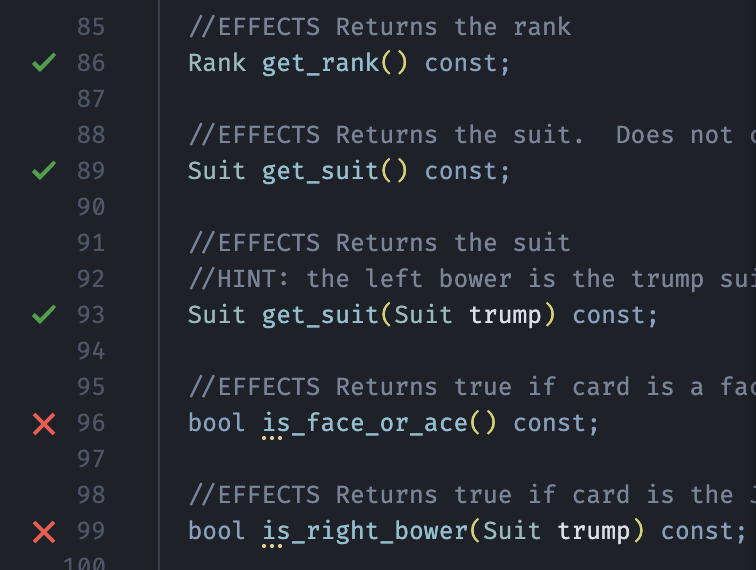

# C++ Implementation Indicator

A local VS Code extension that adds a green check or red cross in the editor gutter next to recognized class-method declarations and free-function declarations, including non-member operator overloads, in headers.

Preview of the gutter indicators

## Install

1. Download `cpp-implementation-indicator-0.3.0.vsix`
2. In VS Code, open Extensions (`Cmd+Shift+X` on macOS).
3. Open the `...` menu and select **Install from VSIX...**.
4. Choose `cpp-implementation-indicator-0.3.0.vsix`.
5. Reload VS Code if prompted.

Alternatively, run `code --install-extension /path/to/cpp-implementation-indicator-0.3.0.vsix`.

## Usage

Open a `.h`, `.hh`, `.hpp`, or `.hxx` file. The extension looks for a same-basename source file (`.cpp`, `.cc`, `.cxx`, or `.c`) in the same directory. If none exists, it optionally searches the workspace. Hover over an icon for a status explanation.

Use **C++ Implementation Indicator: Refresh** from the Command Palette to recalculate indicators.

## Settings

- `cppImplementationIndicator.sourceExtensions`: source file extensions to search (default `.cpp`, `.cc`, `.cxx`, `.c`).
- `cppImplementationIndicator.searchWorkspace`: search the workspace for a same-basename source file if there is no sibling source file.

## Matching notes and limitations

Version 0.3 recognizes free functions and non-member overloaded operators at global scope or in named namespaces, in addition to class methods. It matches signatures using normalized parameter types, and recognizes inline free-function definitions directly in the header. It also preserves source offsets for gutter placement.

This is still a lightweight heuristic parser, not a full C++ compiler frontend. Complex templates, function-pointer declarators, macro-generated declarations, exotic attributes, advanced constraints, anonymous namespaces, and explicitly qualified namespace functions defined outside a namespace block (such as `bool app::operator<(...)`) can be missed. Types expressed through different aliases or syntactically different but equivalent forms may not match. A red cross means no matching definition was recognized by the extension; it is not proof of a linker error. Inline methods inside the class, pure virtual methods, and explicitly deleted/defaulted methods are intentionally not given red crosses.

If your project keeps implementations in a differently named source file, the default same-basename discovery won't find it. Currently the setting supports source extensions, not custom per-header file mappings.
